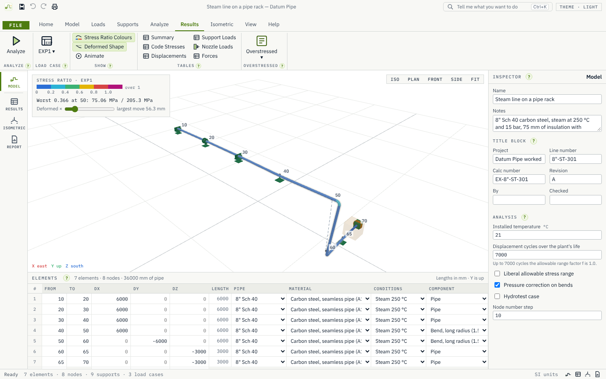
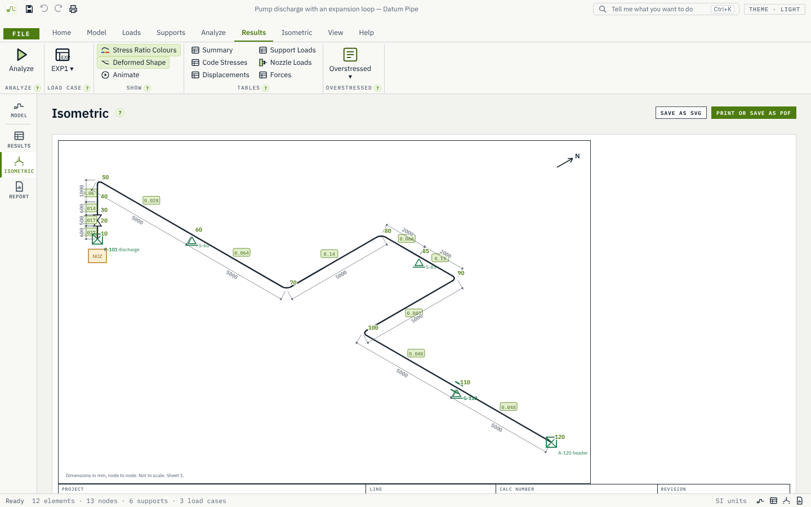
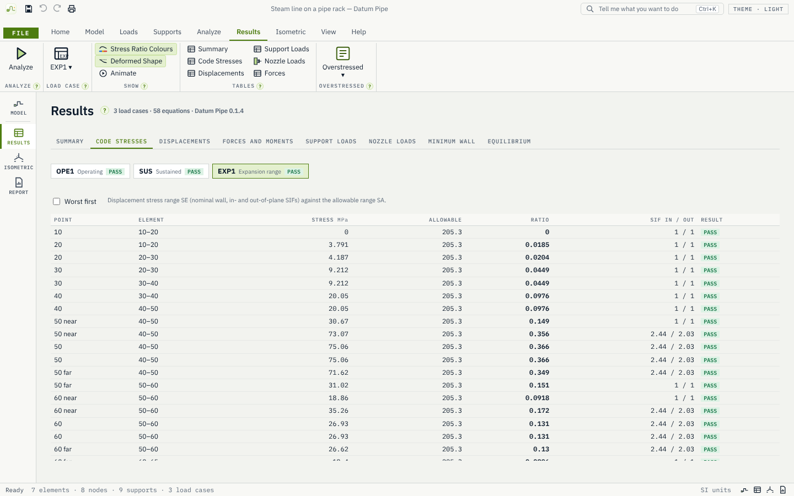
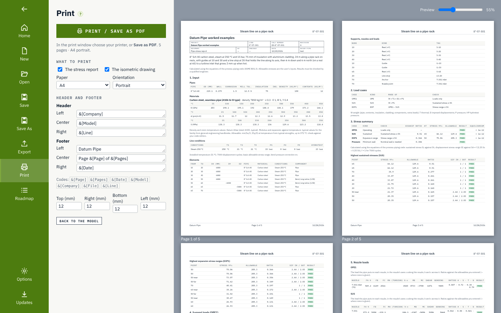

<p align="center"></p>

<h1 align="center">Datum Pipe</h1>

<p align="center">Pipe stress analysis on the desktop: displacements, support loads, nozzle loads and code stresses, with an automatic isometric.</p>

<p align="center">
  <a href="https://github.com/Edgar-Mendonca/Datum-Pipe/releases"></a>
  <a href="https://github.com/Edgar-Mendonca/Datum-Pipe/actions/workflows/ci.yml"></a>
  <a href="https://github.com/Edgar-Mendonca/Datum-Pipe/releases"></a>
  
  
  
  
  
</p>

<p align="center">
  <a href="https://github.com/Edgar-Mendonca/Datum-Pipe/releases/latest"></a>
  <a href="CHANGELOG.md"></a>
  <a href="docs/MEMORY.md"></a>
</p>



Route a piping system in a table, the way a stress engineer marks up an isometric; put on its supports, temperatures and pressures; and Datum Pipe works out the displacements, support loads, equipment nozzle loads and code stresses, shows them on the 3D model and on an isometric drawing, and prints a stress report. It is for piping, stress, mechanical, process and plant engineers, consultants and students. It is free and open source (MIT), Windows first, installs in seconds and updates itself. More on the family site: [edgar-mendonca.github.io/Datum/apps/pipe](https://edgar-mendonca.github.io/Datum/apps/pipe).

> **Results must be checked by a qualified engineer.** Datum Pipe is a tool to help engineers. Before its results are used for design, fabrication or approval, a qualified engineer must check them against the edition of the code that applies to the project.

## What it does

- **An element table that draws as you type**: From node, To node, DX, DY, DZ, pipe, material, line conditions and component. Node numbers step by 10; new rows copy the row above.
- **Pipe data**: nominal sizes ½" to 24" in every schedule, your own sizes, corrosion allowance, mill tolerance, insulation, cladding and contents; carbon, low-alloy, stainless 304 and 316 and duplex steels with modulus and expansion against temperature and their sources.
- **Components**: long and short radius bends or your own radius, welding, fabricated and reinforced tees, concentric reducers, valves and flanged joints with their weight.
- **Supports**: anchors, one-way rests the pipe can lift off, guides, line stops, restraints in any direction (rests, guides, line stops and restraints with gaps and friction), springs, spring hangers sized from your spring table, constant-force supports, nozzle points and imposed equipment movements.
- **Load cases built for you**: sustained, operating, expansion range and hydrotest, editable; wind and static seismic as occasional cases.
- **Code stresses**: hoop stress and minimum wall, sustained longitudinal stress, the displacement stress range and occasional stress, PASS or FAIL at every point.
- **Results**: displacements, forces and moments, support loads for the civil team, nozzle loads in the nozzle's axes, and an equilibrium check after every solve.
- **Isometric and report**: an automatic 30° isometric with dimensions, symbols and result tags (print or SVG), and a printed stress report with the title block, input echo, stress summary, support and nozzle loads, the isometric and the equilibrium checks.
- **Import**: plain-text piping component files (.pcf) from design tools, as a new model.
- **Editing tools**: an expansion loop wizard, copy and mirror a section, insert a node, renumber, undo and redo everything.
- **Verified**: Help › Verification solves benchmark problems with known answers in front of you: beam theory, heated L-bends, Z-bends and an expansion loop against the flexibility method by hand, a bend's flexibility, the minimum wall equation on straight pipe and at a bend's intrados, pressure elongation, a tee branch's effective section modulus, a one-way rest lifting off, a gap closing, friction sliding and sticking, wind and static seismic on a cantilever and the occasional stress, a spring hanger sized by hand, and the equilibrium of every example.
- **Worked examples**: a pump discharge with an expansion loop, a compressor suction line, a steam line on a pipe rack, a tank outlet with settlement, and an L-bend and a Z-bend to check by hand.

| | |
| --- | --- |
|  |  |
| The isometric, drawn from the table | Code stresses at every point |
|  | |
| The stress report, ready to print or save as PDF | |

## About the code checks

Datum Pipe calculates stresses using the published equations of ASME B31.3 (Process Piping). It does not contain the text, tables or figures of the standard. It is not affiliated with or endorsed by ASME.

The equations come from openly published engineering work: Barlow's thin-wall pressure formula and Lamé's thick-cylinder solution, the membrane theory of a torus for the wall of a bend, von Kármán's and Clark and Reissner's theory of curved tubes, A. R. C. Markl's fatigue tests of piping components (1952), Rodabaugh and George's work on pressure in bends (1957), and standard beam theory. Help › Sources in the app lists each equation with its reference.

Some values are tabulated in the standard, such as allowable stresses. In Datum Pipe these are inputs you enter. They are pre-filled with typical values worked out from published minimum material strengths and are marked "check against your code edition".

ASME and B31.3 are trademarks of the American Society of Mechanical Engineers.

## Build it yourself

```bash
npm ci
npm run build:ui
cargo build -p datum-pipe --release
```

Checks: `cargo clippy --workspace --all-targets -- -D warnings`, `cargo test --workspace`, `npm run check:ui`, `npm run test:ui`, `cargo deny check`. See [CONTRIBUTING.md](CONTRIBUTING.md).

## Part of the Datum family

Free, open-source desktop tools for engineers, scientists, researchers and analysts: [edgar-mendonca.github.io/Datum](https://edgar-mendonca.github.io/Datum). MIT licence; see [NOTICE](NOTICE) for third-party code and data.
